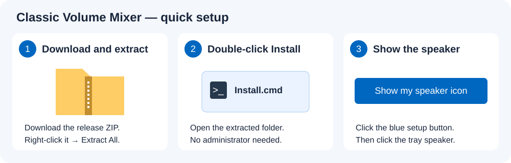

# Classic Volume Mixer

Bring the classic Windows mixer back to your tray.

## Install

1. [Download the install ZIP](https://github.com/AryamanBhardwaj12/classic-volume-mixer/releases/download/v0.2.3.2/ClassicVolumeMixer-0.2.3.2-win-x64-setup.zip), then **Extract All**.
2. Double-click **Install.cmd** in the extracted folder.
3. Click **Show my speaker icon**. Done!

Click the blue tray speaker to open the mixer. It starts automatically when you sign in.

---

A Windows 10/11 **x64** tray launcher for the built-in classic Volume Mixer. Requires .NET Framework 4.8. Windows ARM64, 32-bit Windows and older releases are not validated.

## Setup

Extract the entire versioned release ZIP. It contains dist/ClassicVolumeMixer.exe, Code/Install.ps1, Code/Enable-Startup.ps1, this guide and SHA256SUMS.txt. From PowerShell in that extracted folder run `& .\Code\Install.ps1`.

Setup copies the app to `%LOCALAPPDATA%\ClassicVolumeMixer`, enables startup for your Windows account and launches it. No admin rights needed. Exit an installed copy from its tray menu before updating. If a portable copy is running, exit it and launch the installed executable after setup. You can then delete the extracted release folder.

PowerShell may reject downloaded unsigned scripts under your security policy. Respect that policy. Setup is optional: run dist/ClassicVolumeMixer.exe directly from a permanent extracted location for portable use. Enable portable startup manually by placing a shortcut to it in your Startup folder (`shell:startup`). Keep that executable in place. Source downloads do not contain dist; build first.

## Tray visibility and usage

Left-click the blue speaker to open or restore the mixer at the bottom-right, touching the taskbar. Right-click for Open Mixer, Show icon settings, or Exit. Closing the mixer leaves the tray app running.

Setup shows a small **Keep the speaker visible** page with a **Show my speaker icon** button. Click once to save the visible-icon preference directly; no Windows Settings or dragging. Reopen it through **Keep speaker visible** in the tray menu. This uses an undocumented Windows 11 per-icon registry preference, matched to this exact executable (including filesystem redirection). Other icons are untouched. The button verifies the saved preference and refreshes this icon; actual on-screen visibility is still controlled by Windows. If the record is missing or Windows rejects it, Retry stays available and no success is claimed. Windows 10 and future Windows versions may not support this method. The app does not repeatedly override your choice if you later hide the icon.

The startup shortcut returns the app at sign-in after restart. Windows startup controls or organization policy can disable it. Disable startup by removing Classic Volume Mixer.lnk from your Startup folder. Uninstall by exiting the app, removing that shortcut and deleting `%LOCALAPPDATA%\ClassicVolumeMixer`. The app does not change audio settings itself or replace Windows' sound icon.

## Security

This build is **unsigned**. Internet downloads can show SmartScreen or Smart App Control warnings even if local malware scanning is clean. No publisher reputation is claimed. Do not disable protection, add antivirus exclusions or strip download security metadata. Submit suspected false detections to Microsoft for analysis.

Trusted, timestamped Authenticode signing is the intended public-release route; newly signed files may still show reputation warnings. Microsoft Store MSIX distribution is another option. The runtime has no downloader, network calls, elevation, obfuscation or packer. SHA256SUMS.txt checks extracted contents; compare the ZIP hash against a trusted publisher channel too. Bundled hashes are not a publisher signature.

## Build and package

Run `powershell -NoProfile -File Code/build.ps1` from a source checkout. It uses the Windows .NET Framework x64 compiler with warnings as errors. Run `powershell -NoProfile -File Code/Package.ps1` for a local versioned release ZIP and SHA-256 hash. Packaging does not publish or sign anything. Licensed under MIT (see LICENSE). Clean downloaded-installation acceptance remains unverified.

Tested locally: compilation, real mixer placement and pending/existing process reuse. Full reboot, Explorer restart, clean-machine setup, mixed-DPI movement and download reputation remain acceptance gaps.
