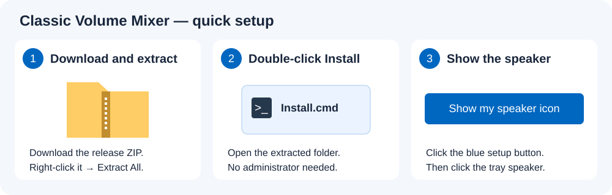

# Install in 3 steps

1. Download the release ZIP and **Extract All**.
2. Open the extracted folder and double-click **Install.cmd**.
3. Click **Show my speaker icon** in setup. Done!

Click the blue tray speaker to open the mixer. It starts again when you sign in.

Windows 10/11 x64, .NET Framework 4.8. Direct icon visibility is a Windows 11 feature.

This app is unsigned, so Windows may warn about an unknown publisher. Don't turn off protection. If your computer blocks setup, use its normal security policy; the portable app is `dist/ClassicVolumeMixer.exe`.
